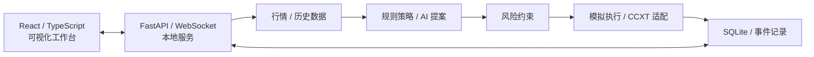

# Smart Money AI Trader

**面向策略研究的 AI 辅助量化交易与可视化工作台**

*AI-Assisted Quantitative Trading Research Workbench*

   

> **当前公开版本：v1.0 · C1 开发检查点（2026-11-03）。** 尚非 Stable/生产就绪版本。已记录的离线回归、历史模拟与 Mock 验证 **不等同于真实资金交易验收**；真实成交闭环与交易所托管保护单生命周期尚未完成验证。

## 项目概览

Smart Money AI Trader 是一个使用 **Python、FastAPI、React 和 TypeScript** 构建的本地量化交易研究平台，围绕行情数据、规则策略、可选 AI 提案、风控约束、订单状态管理和可视化分析，探索**可解释、可追溯、可测试**的智能决策软件架构。

本项目侧重软件工程实践与技术验证，而非收益宣传。仓库中的「24小时翻倍挑战」是策略实验模板及目标名称，**不代表真实收益、盈利保证或经过验证的胜率**。

## 技术亮点

| 方向 | 设计与实现重点 |
|---|---|
| **规则与 AI 分层决策** | 动量、EMA 趋势、RSI 均值回归、成交量异常、ATR 波动等信号；可选 AI 提案经 Schema 检查并受本地风控约束 |
| **风险约束与执行隔离** | 参数约束、仓位与资金校验；区分历史模拟、只读健康检查和需要单独授权的真实执行路径 |
| **订单状态与异常处理** | IOC 请求适配、部分成交/超时/未知订单处理及待核对状态阻断；相关链路已做测试替身验证，非真实成交认证 |
| **可追溯的历史实验** | 历史数据回放、模拟撮合、实验报告、SQLite 事件记录和自动化回归测试 |

## 系统架构



此图为核心模块关系示意，不代表所有外部交易接口已完成实盘联调。

## 当前功能与验证状态

| 范围 | C1 检查点状态 |
|---|---|
| 前端与本地服务 | React 工作台、FastAPI / WebSocket，本仓库附带编译前端 |
| 策略实验 | 历史行情、规则引擎、可选 AI 提案、策略实验室及历史模拟 |
| 自动化测试 | [C1 验收记录](docs/PHASE_C1_RESULTS.md)记录 **106 项回归通过、0 失败**，并通过前端构建和浏览器检查；这是**当期测试记录**，本次文档整理未重新执行测试 |
| 真实资金闭环 | **未通过**：尚缺真实账户下单、成交、撤单、手续费与余额对账的完整验收 |
| 交易所托管保护单 | **未完成**：创建、触发、撤销与重启恢复的全生命周期尚待实现及验收；当前止损主要依赖本地服务在线 |

详细验证证据与限制参见 [实盘验证状态](docs/LIVE_TRADING_VERIFICATION.md)，**不要将 Mock、只读检查或历史回放结果当作实盘验收报告**。

## 快速开始（本地历史模拟）

**环境：** Windows 11、Python 3.11 或以上。本仓库附带已编译的前端，日常启动不需要额外安装 Node.js。

```powershell
git clone https://github.com/cuihanzhe955-commits/SmartMoneyAITrader.git
cd SmartMoneyAITrader
.\start.bat
```

启动器在需要时调用安装脚本并创建本地虚拟环境。工作台默认地址：**http://127.0.0.1:8785**。

进入总览，选择「配置普通交易」→ **内置历史归档 + 规则引擎 + 本地模拟**，创建会话后点击「开始运行」。结束时使用 `stop.bat`。普通模式可配置规则或 AI；当前「24小时翻倍挑战」为规则引擎模板，且默认使用本地模拟。

首次体验建议只使用历史模拟，不需要交易账户或 API 凭据。交易所接入、CSV 格式、风控细节及运行边界请阅读 [完整使用说明](使用说明.md)。

## 代码结构

| 路径 | 职责 |
|---|---|
| `frontend/` | React + TypeScript 前端与构建产物 |
| `terminal/` | FastAPI、WebSocket、配置与会话调度 |
| `ai/` | AI 提案协调、模型服务适配与校验 |
| `market/`、`strategy/`、`risk/` | 数据获取、信号组合、仓位与风险约束 |
| `execution/` | 模拟执行、CCXT 适配、订单状态与恢复 |
| `challenge/`、`events/` | 策略实验生命周期与事件记录 |
| `data/`、`tests/` | 历史行情、规则快照与自动化测试 |

运行数据库等本机状态不随公开源码提供；项目仍保留兼容旧终端的代码路径。详情见 [使用说明](使用说明.md)。

## 开发与复验

```powershell
python -m pip install -r requirements.txt
python -m pip install pytest playwright
python -B tests/run_offline.py
python tests/ui_terminal.py
cd frontend
npm ci
npm run typecheck
npm run build
```

浏览器检查使用本机 Chrome 和测试数据库。部分交易所 HTTP、签名、部分成交及超时测试使用测试替身；**本次 README 更新不涉及业务代码，也没有重新运行上述测试**。

## 项目文档

- [完整使用说明](使用说明.md)：安装运行、交易所配置、策略与回放、资金及风控边界
- [C1 工程验收记录](docs/PHASE_C1_RESULTS.md)：阶段测试证据与未通过项
- [实盘验证状态](docs/LIVE_TRADING_VERIFICATION.md)：哪些已测试、哪些仍待真实账户验收
- [挑战策略模板更新](docs/CHALLENGE_TEMPLATE_UPDATE.md)：策略实验室中的挑战模板交互

## 风险与许可

**当前为研究与开发检查点，不建议直接使用真实资金运行。** 本地止损依赖服务、网络和行情持续可用，异常中断时交易所持仓不一定自动平仓。访问交易所时须遵守所在地法律与平台限制；本项目不提供投资建议或收益保证。

仓库目前**公开可见，但尚未发布开源许可证**，第三方依赖及公开发布许可仍待审计。公开浏览代码不表示授权复制、修改、分发或商业使用。

---

*文档对应 2026-11-03 的 v1.0 C1 公开检查点；后续开发和实际验证情况以相应提交及验收记录为准。*
