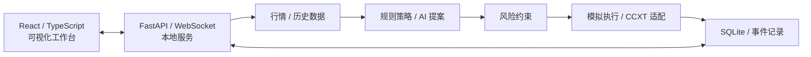

# Smart Money AI Trader

**面向数字资产现货与永续合约的 AI 辅助量化交易工作台**

*AI-Assisted Quantitative Trading Research Workbench*

   

> **当前为开发集成检查点，不是 Stable。** main 已集成 G1、Windows 实例隔离和 G2 通知相关代码；main 的历史集成报告曾记录 938 项离线测试通过，但保护单浏览器、86,401 点图表压力、G1 Worker/Brain 并发和 ConnectionResetError 仍未关闭。PR #2 修订前 HEAD `e5cdfb7` 的 Windows workflow run #12 已成功（[运行记录](https://github.com/cuihanzhe955-commits/SmartMoneyAITrader/actions/runs/42862025213)）：依赖安装、`npm ci`、TypeScript/Vite 构建通过；`tests/run_offline.py` 为 **938 passed / 1 warning**（156.69 秒）；事件研究浏览器和 G1 预测挑战浏览器均通过。该 workflow **没有运行** `tests/protection_browser.py`、`tests/replay_browser.py`、`tests/acceptance_browser.py`，因此四项历史浏览器/压力阻断仍未关闭。历史 run #5 的 937/1 仅属于旧检查点，原因为 Windows checkout 的 CRLF 行尾转换；`.gitattributes` 的 LF 规则已在 run #12 得到验证。 后续文档提交会产生新 HEAD，最终状态以 [PR #2 Checks](https://github.com/cuihanzhe955-commits/SmartMoneyAITrader/pull/2) 的最新检查为准。详情见 [当前进度](docs/PROGRESS_STATUS.md) 与 [集成记录](docs/MAIN_INTEGRATION_20261110.md)。
> **DOC-01 产品合同调整（2026-11-11）：** v0.1 第一版同时纳入纸面交易和真实现货自动交易。真实交易默认关闭，必须独立通过平台、资金、保护、对账、恢复五项实盘门槛并获得明确授权后才能启用。AI 自动决策、AI Provider、策略选择、Brain，以及 OpenClaw、飞书、Telegram 生产通知链路也属于第一版范围，但当前不能据此宣称已完成。

## 项目概览

Smart Money AI Trader 是一个使用 **Python、FastAPI、React 和 TypeScript** 构建的本地量化交易工作台。v0.1 第一版聚焦现货交易，包含规则/AI 决策、纸面执行和受门槛保护的真实现货自动交易；v1.0 的最终方向仍包括现货与永续、模拟与真实交易，以及可解释、可追溯、可测试的风险控制和决策能力。

本项目侧重软件工程实践与可复核验证，不承诺盈利。「24小时翻倍挑战」已获准从产品中移除：先审计路由、配置、调度、数据库、测试、报告和打包依赖，再只删除挑战专属代码与入口；历史报告和历史记录保留。不得连带删除 G1 自动预测挑战、策略实验室、回测、通知或 Brain。历史测试记录不代表真实收益或盈利保证。

## v0.1 第一版交付合同：当前唯一交付主线

2026-11-11 DOC-01 将第一版范围调整为“现货纸面 + 真实现货自动交易”双路径。**v0.1 是第一个可验证里程碑，不是整个产品的最终边界。**

- 一个交易所：由只读核验后的现有代码、数据源稳定性和可测试性决定，不在未检查本机项目之前预先指定。
- 少量现货交易对：优先选择 1–3 个数据完整、流动性和规则信息可核验的交易对。
- 一个可解释的规则策略；策略选择属于第一版能力。
- 纸面交易：明确模拟撮合、手续费、滑点和数据时间戳。
- 真实现货自动交易：规则或 AI 决策经独立风控进入真实订单链，默认关闭。
- AI 自动决策、AI Provider 和 Brain：必须记录版本、延迟、费用、失败和回退；不承诺盈利。
- OpenClaw、飞书和 Telegram：完整生产通知链路必须异步、可恢复且不阻塞交易核心。
- 必须贯通：干净安装 → 启动 → 获取行情 → 策略/AI 决策 → 风控 → 纸面或真实现货执行 → 成交/费用后净值/回撤 → 暂停/停止 → 重启恢复 → 导出与通知。
- 真实现货启用前必须通过平台、资金、保护、对账、恢复五项实盘门槛；永续、事件合约和新增交易所仍按独立范围验收。

### v0.1 主导航目标

1. **首页：** 运行状态、账户/模拟资产、净值、收益、回撤和风险告警。
2. **自动交易：** 选择市场、策略和交易环境，启动、暂停和停止纸面或受控真实现货会话。
3. **历史：** 订单、成交、费用、净值曲线、回撤和导出。
4. **设置：** 数据源、策略、AI Provider、Brain、通知和风险上限。

研究、事件预测、通知、Brain、G1/G2、实验报告和诊断能力默认保留；非核心入口可移至实验区、二级入口或隐藏导航，不得借 UI 收敛删除 API、数据库表、历史数据或测试。「24 小时翻倍挑战」已获准移除：审计依赖后只删除其专属代码、入口、配置、调度和专属测试，保留历史报告/记录；不得影响 G1 自动预测挑战、通用策略实验室、回测、通知或 Brain。

## 技术亮点

| 方向 | 设计与实现重点 |
|---|---|
| **规则与 AI 分层决策** | 动量、EMA 趋势、RSI 均值回归、成交量异常、ATR 波动等信号；可选 AI 提案经 Schema 检查并受本地风控约束 |
| **风险约束与执行隔离** | 参数约束、仓位与资金校验；区分历史模拟、只读健康检查和需要单独授权的真实执行路径 |
| **订单状态与异常处理** | IOC 请求适配、部分成交/超时/未知订单处理及待核对状态阻断；相关链路已做测试替身验证，非真实成交认证 |
| **可追溯的历史实验** | 历史数据回放、模拟撮合、实验报告、SQLite 事件记录和自动化回归测试 |

## 系统架构

此图为核心模块关系示意，不代表所有外部交易接口已完成实盘联调。

## 当前功能与验证状态

功能状态必须区分：源码存在、局部离线测试通过、Mock/测试替身通过、平台联调通过、真实账户验收通过。下方历史阶段数据保留其原始时点，不代表今天所有功能均可用。

下表区分**已有代码/离线证据**与**尚未完成的外部验收**。测试替身、只读公开行情、历史回放和模拟成交都不能替代交易所 demo 或真实账户成交证明。

| 范围 | 当前可确认状态 | 边界与未完成项 |
|---|---|---|
| 前端与本地服务 | React / TypeScript 工作台、FastAPI / WebSocket 本地服务及 Windows 启动器已有代码和构建检查 | 全站最终体验、干净 Windows 安装包和发布迁移仍需 I 阶段验收 |
| 规则与 AI 决策 | 规则扫描与 AI 提案分层；AI 推理工作线程有超时、取消、过期结果检查及规则回退相关代码和离线测试 | AI Brain 长期记忆、模拟结算后自动复盘、跨模型记忆闭环尚未整体验收 |
| 市场研究与模拟 | 三平台公开现货研究适配；异步行情、动态模拟准入、独立持仓保护通道与单主平台隔离已通过本地验收 | Binance地区访问受限；Gate源时间不足导致动态拒绝、私有执行关闭；平台账户验收仍未通过 |
| 订单与保护 | 已有订单状态、部分成交、未知订单阻断、模拟保护生命周期、恢复和只读核对报告的实现及离线测试证据 | 相关 Mock / 模拟验证不代表平台 demo 真实回报；托管保护单的实际平台生命周期仍未通过联调 |
| 历史实验与回放 | 有历史行情模拟、SQLite 事件账本和只读图表回放；D 验收使用24小时历史会话及272笔模拟成交验证回放 | 模拟盈亏不是实盘成绩；回放不驱动真实交易 |
| D 组件与依赖审查 | D 阶段 POC / 条件采用评审完成；495 项隔离离线回归通过、0 失败，前端构建通过 | 这是 D 验收记录，不是495项平台或真实资金验收 |
| 平台与真实资金 | 已有部分 CCXT 协议 POC、公开行情检查和模拟执行基础 | 未完成平台 demo 账户成交闭环；未进行真实资金试单，真实资金验收仍是 Stable 门槛 |

### D 阶段已留存的验收证据

- **Python：** 隔离离线回归 495 通过、0 失败；报告记录执行时间 55.95 秒。
- **前端：** TypeScript / Vite 生产构建通过。
- **浏览器：** 回放、研究、市场发现和监控池回归通过；检查 1366×768、1920×1080 两种尺寸及深浅主题。
- **图表压力：** 100,000 个输入点；24小时回放显示 86,401 个点，首次渲染记录约 1.02–2.12 秒。
- **依赖：** 38 个生产 Python 包、2 个研究 Python 包和185个 npm 锁定节点完成目标环境审查；当次公开公告查询结果为0。
- **隔离边界：** 未访问用户真实账户、未读取真实密钥、未提交交易所订单。上述数字是 D 阶段历史证据；本轮 E 回归另行记录。

详见 [D 阶段最终验收记录](docs/PHASE_D_RESULTS.md)、[组件采用决定](docs/COMPONENT_DECISIONS.md) 和 [依赖审查](docs/OPEN_SOURCE_AUDIT.md)。

### E 阶段非资金验收

- 587项隔离离线回归通过，规则及Mock AI提案均经独立风控进入动态模拟委托/成交，覆盖原固定池之外的交易对。
- 发现、候选扫描、持仓保护使用独立有界通道；市场数据、交易规则、预算、费用、滑点和精度不满足时拒绝模拟成交。
- OKX / Binance / Gate模拟切换独立建立资金、订单、持仓和风控作用域；未知订单、保护单及任意远程环境待核对资产阻止切换。
- 前端设置、主平台能力状态、动态雷达与中文拒绝原因通过1366×768 / 1920×1080、深浅主题检查。
- 公开只读探测与模拟测试分开：OKX可读；Binance返回地区限制；Gate可读但缺少批量行情源时间。三所账户/资金验收均未完成。

详见 [E记录](docs/PHASE_E_RESULTS.md)、[机器可读测试摘要](docs/E_TEST_RESULTS.json)。这是非资金工程检查点，不是完整E外部平台验收或Stable。

### F1–F3事件研究

在策略实验室直接发现开放/已关闭的Polymarket市场，查看ID映射、选择结果查询盘口与基准费率、读取官方结算证据。只读路径不读取凭据，不提交订单。v1指数1费用曲线及成本研究可用；完整实际费用/资产执行验收和模拟闭环尚未开放；官方micro-USDC兑付单位不以现货USDT假设替代。详见[F记录](docs/PHASE_F_READONLY_RESULTS.md)。

## v1.0 阶段路线图

当前优先执行 DOC-01 修订后的 v0.1 范围合同；原 A–I 阶段表继续保留为既有工程阶段与历史验收索引。第一版纳入真实现货、AI 决策、Brain 和生产通知，但各项仍须按证据等级逐项验收；永续、事件合约和更多交易所继续单独安排。

阶段状态以 [项目进度文档](docs/PROGRESS_STATUS.md) 和 [主计划书](docs/SmartMoney_Stable_Plan.md) 为准。当前不使用未经定义权重的单一百分比表示项目完成率。

| 阶段 | 目标 | 当前状态 |
|---|---|---|
| A · 基线审计 | 目录、备份、Git、运行数据和测试基线 | 已有审计记录；发布前仍需复核最新基线 |
| B · 可靠性 | AI 非阻塞、决策过期、订单幂等和异常恢复 | 已有代码与离线测试证据；后续持续回归 |
| C · 实盘核心 | 订单、资金、保护与恢复的端到端验收 | 本地实现持续推进；平台 demo 与真实资金验收未通过 |
| D · 开源组件 | 组件 POC、采用评审、依赖审查和图表回放 | **已完成本阶段组件验收** |
| E · 多交易所 | Gate / OKX / Binance 单主平台切换与隔离 | **非资金实现与本地验收通过；完整 E 的地区/数据源/私有执行与账户验收缺口仍开放** |
| F · Brain 与事件研究 | 模拟学习记忆、Polymarket事件研究 | 研究与参考模拟/Brain非资金工程验收通过；平台忠实执行与真实AI联调继续单列；Gate事件禁用 |
| G · 挑战与通知 | 100轮预测、原规则挑战与异步通道 | G1自动调度/恢复/统计和UI本地验收通过；G2通知与真实持续运行待验收 |
| H · UI 与迁移 | AI Intelligence Center、模型迁移、设置与工作台闭环 | 部分设置和保护界面已有实现；完整中心与迁移未完成 |
| I · Stable 发布 | 全量安装、迁移、平台和发布验收 | 未通过；不得标记 Stable |

**事件平台说明：** Polymarket已接入公开只读研究；官方API证据不等于链上兑付、完整模拟结算闭环或真实交易验收。Gate 事件接口保留为待验证适配目标并默认禁用；Gate / OKX / Binance 现货规划与事件市场适配相互独立。

**真实资金验证安排：** 用户已决定先完成非资金阶段和发布准备，再单独制定真实验收单。近期不要求用户提供实盘密钥，不开展真实资金测试。模拟、Mock 或只读公开行情不能关闭 C 阶段真实验收门槛。

## 快速开始（本地历史模拟）

**系统要求**：Windows 11，Python 3.11 或以上；本轮验证 Python 3.12。前端已编译，普通使用无需 Node.js。当前为 v0.1 产品范围收敛中的开发检查点，**不是 Stable，v0.1 垂直切片尚待实现与验收，完整平台与实盘验收也未通过**。

**无需安装 Git 也能体验**：点击本仓库的 **Code → Download ZIP**，解压后进入包含 start.bat 的项目根目录，**双击 start.bat**。喜欢命令行的开发者可以通过 Git 克隆：

~~~powershell
git clone https://github.com/cuihanzhe955-commits/SmartMoneyAITrader.git
cd SmartMoneyAITrader
.\start.bat
~~~

智能启动器会检查 Python 版本、已有本机服务与端口、项目虚拟环境和 requirements.txt 的依赖；**缺少项目依赖时自动安装到 .venv**，已安装则跳过。首次安装需要网络；没有 Python 时，会提示前往官方页面安装，而不是静默修改系统环境。想只准备依赖、不启动服务，可使用 install.bat。

正常启动后访问 **http://127.0.0.1:8785**；运行期间保持命令行窗口打开。**注意：当前源码界面尚未完成 v0.1 四入口收敛，以下操作仍按现有 G1 检查点的界面组织说明，不代表目标 UI 已交付。**进入总览，选择「配置普通交易」→ **内置历史归档 + 规则引擎 + 本地模拟**，创建会话后再点击「开始运行」。结束时使用 stop.bat 安全退出。也可创建公开现货的动态模拟会话；地区或源时间不满足条件时显示拒绝原因，内置历史模拟仍可使用。

**遇到 Python 未识别、pip 安装失败、端口占用或刷新后打不开？** 请查看 [Windows 快速启动与常见问题](docs/WINDOWS_QUICK_START.md)。交易所接入、CSV 格式、风控细节及运行边界请阅读 [完整使用说明](使用说明.md)。

## 代码结构

| 路径 | 职责 |
|---|---|
| `frontend/` | React + TypeScript 前端与构建产物 |
| `terminal/` | FastAPI、WebSocket、配置与会话调度 |
| `ai/` | AI 提案协调、模型服务适配与校验 |
| `market/`、`strategy/`、`risk/` | 数据获取、信号组合、仓位与风险约束 |
| `execution/` | 模拟执行、CCXT 适配、订单状态与恢复 |
| `challenge/`、`events/` | 策略实验生命周期与事件记录 |
| `data/`、`tests/` | 历史行情、规则快照与自动化测试 |

运行数据库等本机状态不随公开源码提供；项目仍保留兼容旧终端的代码路径。详情见 [使用说明](使用说明.md)。

## 开发与复验

以下命令用于本地复验；运行环境、依赖版本和浏览器条件会影响结果。

~~~powershell
python -m pip install -r requirements.txt
python -X utf8 -B tests/run_offline.py
npm --prefix frontend ci
npm --prefix frontend run build
~~~

早期 D/E/F 阶段测试与后续 GitHub Windows CI 对应不同提交和测试范围，不能混用。当前已有 Windows CI 验证离线回归、前端构建及指定浏览器检查，但尚未覆盖全部保护单、压力、安装和真实平台验收；原始证据见 [当前进度](docs/PROGRESS_STATUS.md) 及各阶段报告。

## 项目文档

- [项目进度与验收口径](docs/PROGRESS_STATUS.md)：当前事实、历史证据、v0.1 验收和未关闭门槛
- [v0.1 范围合同](docs/V0_1_SCOPE_CONTRACT.md)：第一版纸面/真实现货范围、五项实盘门槛和验收清单
- [产品与工程审计记录](docs/PRODUCT_AUDIT_20261111.md)：审计结论、采纳/不采纳决定及证据分类
- [AI 协作开发规范](docs/AI_DEVELOPMENT_COLLABORATION.md)：额度切换、分支隔离、任务交接、测试和安全边界
- [主实施计划书](docs/SmartMoney_Stable_Plan.md)：v1.0 冻结范围、平台优先级和后续执行依据
- [文档导航与仓库结构](docs/README.md)：按计划、使用、验收和未来候选分类查看项目资料
- [v1.0 公开开发路线图](docs/V1_ROADMAP.md)：A–I 阶段目标及验收边界
- [D 阶段最终验收](docs/PHASE_D_RESULTS.md)：组件 POC、495项离线回归、图表回放和依赖审查
- [组件采用决定](docs/COMPONENT_DECISIONS.md)：CCXT、TA-Lib、Pydantic AI、Lightweight Charts 等组件评审
- [依赖与开源组件审查](docs/OPEN_SOURCE_AUDIT.md)：目标环境依赖、许可证和公开公告检查
- [D3 市场发现](docs/PHASE_D3_DISCOVERY.md) / [D4 监控池隔离](docs/PHASE_D4_MONITOR_POOL.md)：只读市场研究和必须监控集合边界
- [C2 保护生命周期](docs/PHASE_C2_LIFECYCLE.md) / [C3 模拟联调准备](docs/PHASE_C3_READINESS.md)：本地模拟保护与只读预检证据
- [C1 历史工程验收](docs/PHASE_C1_RESULTS.md)：早期检查点的历史记录，不代表当前阶段
- [实盘验证状态](docs/LIVE_TRADING_VERIFICATION.md)：按平台/产品区分已测试和未验收项
- [Windows 快速启动与常见问题](docs/WINDOWS_QUICK_START.md)：安装、启动和排障
- [完整使用说明](使用说明.md)：安装运行、交易所配置、策略与回放、资金及风控边界
- [中文 Git 双端安全同步工具](tools/git_sync/README.md)：Windows 一键审计、备份和无冲突安全同步

## ☕ 支持开发者

如果 Smart Money AI Trader 对你有所帮助，欢迎通过开发者个人提供的付费服务，支持项目后续维护与开发。支持完全自愿，不影响任何人阅读本仓库。

> [!NOTE]
> **ChatGPT 订阅代充协助服务 · ¥135 CNY**
>
> 该服务由开发者个人提供，**不是 OpenAI 官方服务或授权代理**，价格不代表官方订阅定价。购买前请确认具体套餐、期限、交付方式、退款规则和适用地区；请勿向他人提供账户密码或验证码。

**购买咨询 / 联系开发者**

以下二维码由开发者提供的联系方式重新生成，分别对应微信、QQ、Telegram 的添加入口。**扫码或点击二维码均可尝试联系**，不需要公开留言或提供账户密码。

| 微信 WeChat | QQ | Telegram |
| :---: | :---: | :---: |
|  |  |  |
| 微信号：`PuRP1E22` | QQ：`1632832719` | [@LingYuChrisOedipus](https://t.me/LingYuChrisOedipus) |

> 温馨提示：二维码跳转可能需要相应 App。请先通过上述渠道确认具体服务条款及金额，再决定是否购买。

**请先沟通确认，不要直接付款。** 本仓库不收款，不设置自动交易或自动充值功能；上述服务与 Smart Money AI Trader 的软件功能、运行安全及项目许可证相互独立。
## 风险与许可

**当前为研究与开发检查点，不建议直接使用真实资金运行。** 本地止损依赖服务、网络和行情持续可用，异常中断时交易所持仓不一定自动平仓。访问交易所时须遵守所在地法律与平台限制；本项目不提供投资建议或收益保证。

仓库目前**公开可见，但尚未发布开源许可证**，第三方依赖及公开发布许可仍待审计。公开浏览代码不表示授权复制、修改、分发或商业使用。

---

*历史文档补录日期：2026-11-06。2026-11-11 DOC-01 产品合同调整见 v0.1 范围合同和主计划 §16.14；历史阶段证据继续保留，不把文档同步计为功能实现。*
