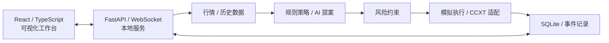

# Smart Money AI Trader

**面向策略研究的 AI 辅助量化交易与可视化工作台**

*AI-Assisted Quantitative Trading Research Workbench*

   

> **当前公开版本：v1.0 · C1 开发检查点（2026-11-03）。** 尚非 Stable/生产就绪版本。已记录的离线回归、历史模拟与 Mock 验证 **不等同于真实资金交易验收**；真实成交闭环与交易所托管保护单生命周期尚未完成验证。

## 项目概览

Smart Money AI Trader 是一个使用 **Python、FastAPI、React 和 TypeScript** 构建的本地量化交易研究平台，围绕行情数据、规则策略、可选 AI 提案、风控约束、订单状态管理和可视化分析，探索**可解释、可追溯、可测试**的智能决策软件架构。

本项目侧重软件工程实践与技术验证，而非收益宣传。仓库中的「24小时翻倍挑战」是策略实验模板及目标名称，**不代表真实收益、盈利保证或经过验证的胜率**。

## 技术亮点

| 方向 | 设计与实现重点 |
|---|---|
| **规则与 AI 分层决策** | 动量、EMA 趋势、RSI 均值回归、成交量异常、ATR 波动等信号；可选 AI 提案经 Schema 检查并受本地风控约束 |
| **风险约束与执行隔离** | 参数约束、仓位与资金校验；区分历史模拟、只读健康检查和需要单独授权的真实执行路径 |
| **订单状态与异常处理** | IOC 请求适配、部分成交/超时/未知订单处理及待核对状态阻断；相关链路已做测试替身验证，非真实成交认证 |
| **可追溯的历史实验** | 历史数据回放、模拟撮合、实验报告、SQLite 事件记录和自动化回归测试 |

## 系统架构



此图为核心模块关系示意，不代表所有外部交易接口已完成实盘联调。

## 当前功能与验证状态

| 范围 | C1 检查点状态 |
|---|---|
| 前端与本地服务 | React 工作台、FastAPI / WebSocket，本仓库附带编译前端 |
| 策略实验 | 历史行情、规则引擎、可选 AI 提案、策略实验室及历史模拟 |
| 自动化测试 | [C1 验收记录](docs/PHASE_C1_RESULTS.md)记录 **106 项回归通过、0 失败**，并通过前端构建和浏览器检查；这是**当期测试记录**，本次文档整理未重新执行测试 |
| 真实资金闭环 | **未通过**：尚缺真实账户下单、成交、撤单、手续费与余额对账的完整验收 |
| 交易所托管保护单 | **未完成**：创建、触发、撤销与重启恢复的全生命周期尚待实现及验收；当前止损主要依赖本地服务在线 |

详细验证证据与限制参见 [实盘验证状态](docs/LIVE_TRADING_VERIFICATION.md)，**不要将 Mock、只读检查或历史回放结果当作实盘验收报告**。

**最新本地进展（开发者报告；尚未同步源码，2026-11-03）**：项目总体完成度约 **25%**，处于 **C 阶段（第 3/9 阶段）**。本地已完善**旧验收报告失效提示**：界面定期刷新报告状态，进程重启、报告超过 **60 秒**，或账户、配置、持仓发生变化后，将提示 **「需要重新核验」**，过期报告不会恢复交易授权。开发者反馈本轮相关 **103 项测试通过、0 失败**，前端构建及浏览器验证通过；**以上是尚未上传的本地修改及其测试结果，不是当前 GitHub 源码的可复验结论**。本地已保存并暂停后续工作；本轮未生成新发布包或阶段日志。

**测试口径说明**：上表 **106 项**是此前 C1 公开检查点的历史回归记录；本轮 **103 项**属于不同的本地验证范围，**不能直接视为测试数量下降，也不能混用为同一份验收报告**。


## 未来发展路线图（Roadmap）

> **路线图性质**：本节描述项目的**阶段目标、技术研究方向和候选能力**，不表示功能已经上线，也不构成收益或交付时间承诺。当前公开代码仍是 **v1.0 · C1 开发检查点**，阶段 C 整体验收尚未通过。**v1.0 的既定需求范围已冻结**：现阶段首先补齐实现与验收，不因路线图扩展现有交付范围；后续设想须另行评审，才会进入未来版本。

### 项目长期愿景

围绕「**数据获取 → 策略分析 → AI 辅助提案 → 独立风险约束 → 模拟/授权执行 → 事件审计与结果评估**」构建模块化研究平台。系统希望逐步提高实验可复现性、策略决策的可解释性以及异常场景下的可靠性；**自动化程度提高不等于放宽权限、取消风控或保证盈利**。

| 发展阶段 | 核心目标 | 当前状态 | 预期产出 |
|---|---|---|---|
| **第一阶段：v1.0 完善与验收** | 补齐既定交易执行与保护机制，验证数据一致性、异常恢复和系统可用性 | **当前优先；未完成** | 可复核的测试记录、订单与资金对账证据、明确的适用边界 |
| **第二阶段：研究能力与平台扩展** | 强化行情数据、策略对照、决策回放、可视化和可扩展适配器 | **未来版本候选** | 可重复的研究实验、策略分析报告、模块化接口 |
| **第三阶段：可审计的 AI 辅助研究** | 研究 AI 记忆、长期评估、多角色协作与受控自动化 | **长期探索方向** | 可解释的决策档案、评价基准与受约束的智能体实验 |
| **贯穿各阶段：工程质量与开放协作** | 自动化测试、文档、依赖与发布审查 | **持续开展；部分待完善** | 可维护的工程结构与可信的版本记录 |

### 第一阶段｜v1.0：从开发检查点走向可验证交付

**目标：** 不增加新的产品需求，优先解决影响正确性、安全性和可复现性的既有工程问题。当前 C1 记录显示离线回归与浏览器测试取得阶段成果，但**真实资金闭环、托管保护单全生命周期和部分平台联调仍未验收**。

**重点工作：**

1. **订单生命周期完整性**：覆盖提交、接受/拒绝、部分成交、完全成交、撤单、超时和未知状态；对相同客户端订单号进行幂等查证，禁止在结果不明时盲目重复下单。
2. **资金与持仓一致性**：核对下单前后余额、成交数量与价格、不同费用币种、最小下单额、交易精度及持仓变动；出现账本差异或外部订单时及时阻断后续操作。
3. **保护与故障恢复**：完成并验证交易所托管保护单的创建、触发、取消、重新启动后核对等生命周期；明确本地止损与托管保护的区别，测试断网、进程退出、API 异常等情形。
4. **权限及适用性校验**：隔离只读检查、模拟执行与真实账户授权；按交易所官方规则及账户实际权限核验，遵守地区限制，不绕过接口封锁。
5. **质量与交付**：补齐干净 Windows 环境的安装启动检查、端到端回归、异常注入、日志脱敏、故障复盘及回滚文档，确保测试结果可以按提交版本追溯。

**阶段验收标准（拟采用）：** 对关键订单状态和失败路径保留可复核测试证据；在适用、合法且获得单独授权的前提下，按受控范围完成真实账户订单、成交、撤单、费用、余额及保护状态的核对；对无法确认的状态坚持暂停和人工核查。**未取得上述证据前，不标记 Stable，也不宣称已具备生产级实盘可靠性。**

### 第二阶段｜研究平台与策略分析能力扩展（未来版本候选）

在 v1.0 验收之后，才考虑把现有交易工作台逐步发展为更通用的**量化策略实验与可视化分析平台**。以下方向均需独立的需求评审、接口设计、测试方案和版本计划：

| 研究方向 | 拟探索的能力 | 重点难点与评价依据 |
|---|---|---|
| **多源行情与适配器** | 统一历史/实时数据模型，评估更多依法可用的数据源和平台接口，支持时间戳、精度与交易规则规范化 | 数据缺失、延迟、时间同步、接口版本差异、平台可用性 |
| **策略表现分析器** | 按策略、标的、时段及市场状态整理交易分布、成本、最大回撤、盈亏结构等指标 | 明确手续费/滑点口径；区分模拟净值与真实账单 |
| **AI 决策回放室** | 将输入摘要、策略信号、AI 提案、风控裁剪理由及执行结果关联展示 | 数据可追溯、复现实验、避免泄露私有凭据与隐私 |
| **影子交易员与策略对照** | 同一组历史行情下对比规则基线、AI 提案和不实际下单的影子策略 | 统一数据窗口与成本假设，避免未来函数、选择偏差和过拟合 |
| **交互体验与通知** | 优化策略实验室、风险提示、报告可视化；研究经授权的飞书/其他通知渠道 | 事件去重、告警可达性、通知权限与敏感内容过滤 |

**预期研究成果：** 不只是提供更多按钮，而是形成可重复的策略对照实验、统一的指标定义、能解释「为何建议、为何拒绝、为何执行」的决策档案，以及相应测试报告。

### 第三阶段｜长期 AI 辅助决策研究（探索性设想）

长期希望研究具有**可审计记忆和持续评估机制**的 AI 辅助系统，但不会把“自主学习”“自主进化”直接等同于有效策略或生产级能力。

- **可控的 AI 决策记忆**：探索保存策略上下文、历史决策及结果反馈，建立可查看、可清理、可回滚的记忆记录，并评估其是否真正改善分析质量。
- **多角色分析与规则兜底**：研究不同模型或分析角色如何提出、审阅和比较交易假设；最终风险约束由独立、可测试的执行规则控制，AI 输出不得直接绕过授权和硬性安全门槛。
- **长期策略评价**：使用滚动窗口、样本外数据、基线策略、模拟成本及压力场景观察模型稳定性，不以少量有利样本宣称高胜率。
- **可解释与人机协同**：展示数据来源、模型建议、关键不确定性、风险拒绝原因及用户干预记录；重大权限变更和真实资金操作必须有明确授权。
- **研究边界**：候选功能的实际价值需由可重复实验和审计记录证明；不承诺自动赚钱、固定胜率、特定收益率，也不设未经验证的上线日期。

### 工程原则与路线图维护

- **证据先于宣传**：区分「构想 / 开发中 / 离线测试通过 / 平台联调通过 / 真实账户验收通过」，不把 Mock 结果、历史回放收益或界面完成度描述为实盘成绩。
- **安全优先于自动化**：未知订单、资金不一致、交易所限制和保护机制异常时默认暂停，不以激进实验为由取消必要约束。
- **版本边界明确**：v1.0 继续按已冻结范围交付；新想法进入未来版本候选清单，不在当前版本中临时插入。
- **逐步完善开放协作**：持续维护使用文档、验收记录与变更历史；待依赖和许可审查完成后，再决定是否发布正式开源许可证和稳定版本。

相关当前证据参见 [C1 工程验收记录](docs/PHASE_C1_RESULTS.md) 与 [实盘验证状态](docs/LIVE_TRADING_VERIFICATION.md)。路线图将随**实际已完成的工程工作与验证结果**更新，而不是仅依据开发计划改变状态。


## 快速开始（本地历史模拟）

**系统要求**：Windows 11，Python 3.11 或以上；推荐先使用 Python 3.11。前端已编译，普通使用无需 Node.js。当前仍是 C1 开发检查点，**实盘未完成验收**。

**无需安装 Git 也能体验**：点击本仓库的 **Code → Download ZIP**，解压后进入包含 start.bat 的项目根目录，**双击 start.bat**。喜欢命令行的开发者可以通过 Git 克隆：

~~~powershell
git clone https://github.com/cuihanzhe955-commits/SmartMoneyAITrader.git
cd SmartMoneyAITrader
.\start.bat
~~~

智能启动器会检查 Python 版本、已有本机服务与端口、项目虚拟环境和 requirements.txt 的依赖；**缺少项目依赖时自动安装到 .venv**，已安装则跳过。首次安装需要网络；没有 Python 时，会提示前往官方页面安装，而不是静默修改系统环境。想只准备依赖、不启动服务，可使用 install.bat。

正常启动后访问 **http://127.0.0.1:8785**；运行期间保持命令行窗口打开。进入总览，选择「配置普通交易」→ **内置历史归档 + 规则引擎 + 本地模拟**，创建会话后再点击「开始运行」。结束时使用 stop.bat 安全退出。

**遇到 Python 未识别、pip 安装失败、端口占用或刷新后打不开？** 请查看 [Windows 快速启动与常见问题](docs/WINDOWS_QUICK_START.md)。交易所接入、CSV 格式、风控细节及运行边界请阅读 [完整使用说明](使用说明.md)。

## 代码结构

| 路径 | 职责 |
|---|---|
| `frontend/` | React + TypeScript 前端与构建产物 |
| `terminal/` | FastAPI、WebSocket、配置与会话调度 |
| `ai/` | AI 提案协调、模型服务适配与校验 |
| `market/`、`strategy/`、`risk/` | 数据获取、信号组合、仓位与风险约束 |
| `execution/` | 模拟执行、CCXT 适配、订单状态与恢复 |
| `challenge/`、`events/` | 策略实验生命周期与事件记录 |
| `data/`、`tests/` | 历史行情、规则快照与自动化测试 |

运行数据库等本机状态不随公开源码提供；项目仍保留兼容旧终端的代码路径。详情见 [使用说明](使用说明.md)。

## 开发与复验

```powershell
python -m pip install -r requirements.txt
python -m pip install pytest playwright
python -B tests/run_offline.py
python tests/ui_terminal.py
cd frontend
npm ci
npm run typecheck
npm run build
```

浏览器检查使用本机 Chrome 和测试数据库。部分交易所 HTTP、签名、部分成交及超时测试使用测试替身；**本次 README 更新不涉及业务代码，也没有重新运行上述测试**。

## 项目文档

- [完整使用说明](使用说明.md)：安装运行、交易所配置、策略与回放、资金及风控边界
- [C1 工程验收记录](docs/PHASE_C1_RESULTS.md)：阶段测试证据与未通过项
- [实盘验证状态](docs/LIVE_TRADING_VERIFICATION.md)：哪些已测试、哪些仍待真实账户验收
- [挑战策略模板更新](docs/CHALLENGE_TEMPLATE_UPDATE.md)：策略实验室中的挑战模板交互

## ☕ 支持开发者

如果 Smart Money AI Trader 对你有所帮助，欢迎通过开发者个人提供的付费服务，支持项目后续维护与开发。支持完全自愿，不影响任何人阅读本仓库。

> [!NOTE]
> **ChatGPT 订阅代充协助服务 · ¥135 CNY**
> 

**购买咨询 / 联系开发者**

| 联系方式 | 账号 / 入口 |
| :-- | :-- |
| **微信 WeChat** | `PuRP1E22`（在微信中搜索添加） |
| **QQ** | `16630125861`（在 QQ 中搜索添加） |
| **Telegram** | [@LingYuChrisOedipus](https://t.me/LingYuChrisOedipus) |

**请先沟通确认，不要直接付款。** 本仓库不收款，不设置自动交易或自动充值功能；上述服务与 Smart Money AI Trader 的软件功能、运行安全及项目许可证相互独立。
## 风险与许可

**当前为研究与开发检查点，不建议直接使用真实资金运行。** 本地止损依赖服务、网络和行情持续可用，异常中断时交易所持仓不一定自动平仓。访问交易所时须遵守所在地法律与平台限制；本项目不提供投资建议或收益保证。

仓库目前**公开可见，但尚未发布开源许可证**，第三方依赖及公开发布许可仍待审计。公开浏览代码不表示授权复制、修改、分发或商业使用。

---

*文档对应 2026-11-03 的 v1.0 C1 公开检查点；后续开发和实际验证情况以相应提交及验收记录为准。*
