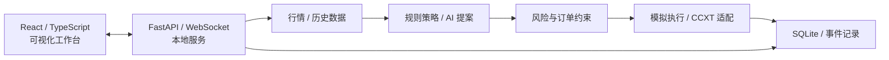

# Smart Money AI Trader

**AI 辅助量化交易研究与可视化工作台**  ·  *AI-Assisted Quantitative Trading Research Workbench*

   

> **版本声明（2026-11-03）**：当前公开代码为 **v1.0 · C1 开发检查点**，**不是 Stable / 生产就绪版本**。已记录的离线测试与模拟交易结果不等于真实账户成交验证；**尚未完成真实资金交易闭环及托管保护单的完整验收**。

## 项目简介

Smart Money AI Trader 是一个面向**软件工程实践、智能决策研究及金融数据可视化**的个人开发项目。项目尝试将规则量化策略、可选的 AI 分析提案、风险约束、订单生命周期管理和 React 可视化工作台组织为可测试、可追溯的本地应用。

项目重点是**模块化架构、决策可解释性、风控约束和异常恢复**。它不是盈利保证工具，也不构成投资建议；仓库中出现的「24小时翻倍挑战」是历史/模拟实验模板及目标名称，**不代表实际收益或可实现的投资回报**。

## 当前功能与验证边界

| 模块 / 能力 | 当前说明 |
|---|---|
| 本地工作台 | React + TypeScript 前端，FastAPI / WebSocket 后端；包含已编译前端产物 |
| 市场数据与历史回放 | 支持内置历史数据与 CSV 导入、回放和模拟订单检查 |
| 规则策略与 AI 提案 | 动量、趋势、均值回归、成交量、波动率等规则信号；可配置 AI 服务，提案受本地风控约束 |
| 策略实验室 | 「24小时翻倍挑战」已整合进策略模板；当前挑战模式使用规则引擎 |
| 风险与订单状态 | 包含仓位约束、IOC 适配、订单状态记录、异常和待核对订单阻断等实现 |
| C1 离线与界面验收 | [C1 记录](docs/PHASE_C1_RESULTS.md)报告 **106 项回归通过、0 失败**，并完成前端构建与浏览器检查；使用历史数据/模拟账户或测试替身 |
| 真实账户与资金闭环 | **未通过验收**；本轮未执行真实资金下单、成交、撤单及费用对账完整闭环 |
| 交易所托管保护单 | **未完成创建、触发、撤销、重启恢复全生命周期的实现与验收**；现有止损主要依赖本地服务在线 |

上述为 **C1 检查点记录和源码功能边界**，不代表本仓库已经通过独立安全审计、真实交易所联调或生产级验证。详见 [实盘验证状态](docs/LIVE_TRADING_VERIFICATION.md)。

## 系统结构



该图仅说明**主要模块职责与数据流**；实际交易路径、授权门槛与风险限制以源码及阶段验证记录为准。

## 项目文档

- [C1 工程验收记录](docs/PHASE_C1_RESULTS.md)：离线测试、构建、浏览器检查、已知未通过项。
- [真实交易验证状态](docs/LIVE_TRADING_VERIFICATION.md)：模拟/Mock 与实盘验证的区别、待完成门槛。
- [挑战策略模板更新](docs/CHALLENGE_TEMPLATE_UPDATE.md)：策略实验室中的挑战配置。
- [使用说明](使用说明.md)：安装与使用细节。
- [GitHub 源码上传及清理说明](docs/GITHUB_UPLOAD.md)：源码导出范围、敏感文件排除与发布注意事项。

---

## 使用与开发

## 运行

Windows 11、Python 3.11 或以上。双击 `start.bat` 打开本机工作台，默认端口 8785。首次缺依赖时启动器会调用 `install.bat`，后者在项目内创建 .venv。已经包含编译好的 React 前端，运行时无需 Node。使用 `stop.bat` 安全退出，若有未核对订单，程序会先要求核对。

首次使用在总览点击「配置普通交易」。选择内置历史归档、规则引擎和本地模拟即可完全离线运行。创建后需要再点击「开始运行」。普通交易支持规则或 AI；24 小时挑战保持纯规则。每次只调度一个会话。

## 接入 OKX 全球站或 Binance.com

1. 打开「设置」，选择交易所与交易所模拟或真实账户环境，输入该环境签发的交易 API 凭据。OKX 还需要 Passphrase。仅需交易与读取权限。Windows DPAPI 把保存的凭据绑定到当前 Windows 用户，GET 设置接口返回已配置状态。
2. 选择现货并点击「检查余额」，这里只验证余额读取。创建交易所现货会话后，可在「设置 → 实盘验收」检查权限、资金、规则、盘口和未核对订单。检查不会启动会话。平台访问和地区资格按实际账户核实；旧网络测试结果不能代替当前检查。
3. 在普通交易或挑战配置里选择执行环境、实时行情、交易所、产品和资金预算。实盘在创建与启动时均需输入「启用实盘」。授权启动后，程序会根据策略自主提交订单。模拟环境凭据与生产环境凭据分别保存。
4. 新实盘会话仅开放现货，历史永续记录与查单路径保留。资金验收要求专用账户与策略现金、持仓精确匹配；不能把普通大账户中的名义预算称为资金隔离。第三币种费用无法可靠估值时暂停等待核对。未经核对的条件单阻止实盘启动，不会将外部止损单自动认领为策略保护。
5. 服务端核验实际可用资金、持仓、未结委托、盘口、价格偏离、交易精度和最小订单。实盘采用带价格上限或下限的 IOC 委托。未成交部分取消，只对交易所确认的实际成交数量、价格和费用入账。HTTP 451 会停机，不会切换域名或代理。
6. 发生提交超时会按原客户端订单编号查单，禁止创建替代订单。尚未找到最终回报时保持暂停。交易所显示已成交但日志显示待核对时，请在交易所核对对应订单与费用；状态未能消除前不要再次发起交易。进程重启后，交易所会话默认暂停，并继续核对已提交的订单。

### 资金与运行边界

- 页面「策略归因净值」按本次名义预算、归属本策略的成交与持仓估值计算。交易所可用 USDT 由私有接口读取，单独显示。实盘报告未纳入永续资金费、外部转入转出或强平调整，不能代替账户账单。
- 止损、移动止损和回撤熔断由本地服务计算。它们依赖程序、行情和网络在线。暂停、断网、紧急停止或退出后，已有实盘持仓仍在交易所，程序不会替你强行平仓。逐仓永续存在强平风险，10 USDT 可能不足以下单。翻倍是实验目标。
- 实盘不接受历史行情。公开接口可用也不能证明账号有私有接口或交易权限。本次交付没有使用真实账户密钥、调用付费 AI 或发送真实资金订单。

## 规则、AI 和回放

普通模式默认较低仓位、较长冷却和较低资金利用率；挑战拥有独立默认预设。五组信号覆盖动量突破、EMA 趋势、RSI 均值回归、成交量异常与 ATR 波动，组合器在有效行情上筛选。来源、参数、买卖依据和风控结果可从决策中心及记录详情查看。

AI 可设置 HTTPS Base URL、模型、密钥、超时、调用间隔、每个会话的请求次数预算，以及失败时回退规则或暂停开仓。一次提案最多消耗两次请求。服务先提供市场分析，再给出经过 Schema 验证的方向、币种、仓位比例、风险和退出计划。仓位经过本地上限裁剪，AI 提议卖出优先级低于硬止损。执行中的硬参数优先于文本退出计划。请求预算以次数计量，未接入供应商账单。

历史档案使用 2024-08-05 UTC 的 8 个 Binance 现货交易对，并用前一日预热。历史回测页支持 UTF-8 CSV，列名为 `symbol,timestamp,open,high,low,close,quote_volume`。时间戳必须是分钟收盘的 Unix 秒数，不能使用开盘时间。各币种需按时间递增、每分钟连续，至少 76 行。24 小时挑战还需要完整 24 小时公共窗口。普通历史模式暂停后可单步。支持变速播放、按不同预设对照历史报告。

模拟订单等待下一根有效收盘线，再检查流动性、仓位、资金、手续费和滑点。过期、过小或风控失败的订单会取消。严格模拟可选 OKX 现货公开规则快照，包含最小数量、数量步长、价格档位和可得的最小金额。快照时间保存在数据文件与参数内，它并非 2024 年历史当天规则。微资金模式可自行设置最小模拟金额。实时交易总是使用所连交易所的当前规则。

## 项目结构

| 目录 | 用途 |
|---|---|
| terminal/ | FastAPI、WebSocket、本地安全配置、交易会话调度 |
| frontend/ | React + TypeScript 源码和 dist 产物 |
| ai/ | 双阶段 AI 提案、Schema 与服务适配 |
| market/、strategy/、risk/ | 真实行情、CSV、规则指标、仓位上限 |
| execution/ | 模拟委托、订单状态机、CCXT 连接器、持久化实盘意图与回报核对 |
| challenge/、events/ | 生命周期、报告与 SQLite 审计记录 |
| data/ | 可离线使用的原始数据和规则快照 |
| tests/ | 回归、输运签名、完整回放、浏览器验收与截图 |
| runtime/ | 本机数据库和加密凭据，排除在交付 ZIP 外 |

新工作台使用 runtime/terminal.db。旧挑战终端使用 runtime/challenges.sqlite3；旧界面、数据和历史测试入口保留，可通过 launch.py 访问旧档案。在旧终端创建的记录不会混入新工作台的报告列表。

## 开发复验

```powershell
python -m pip install -r requirements.txt
python -m pip install pytest playwright
python -B tests/run_offline.py
python tests/ui_terminal.py
cd frontend
npm ci
npm run typecheck
npm run build
```

浏览器验收使用本机 Chrome 和临时数据库。交易所回报、超时和部分成交测试使用测试替身，签名与 IOC 编码测试截获 CCXT 发出的 HTTP 请求。签名路径已测试不等于交易所已接收真实委托。

接口依据：[OKX API V5](https://www.okx.com/docs-v5/en/)，[Binance Spot](https://developers.binance.com/docs/binance-spot-api-docs/rest-api/trading-endpoints)，[Binance USDⓈ-M Futures](https://developers.binance.com/docs/derivatives/usds-margined-futures/trade/rest-api/New-Order)。

## 安全、合规与公开范围

- **不要上传秘密信息**：API Key、Secret、Passphrase、`.env`、`runtime/`、数据库、交易账户标识、私人交易流水及日志等不应进入仓库。现有 `.gitignore` 仅帮助排除新文件，不能自动清理历史提交；公开前后都应检查历史记录并轮换任何疑似泄露的凭据。
- **真实资金风险**：本地止损和移动止损依赖行情、网络及进程在线；暂停或断网时持仓可能仍留在交易所。只读健康检查、模拟回放与签名测试**不能替代真实账户闭环验收**，不建议直接投入真实资金运行当前开发检查点。
- **交易权限与地区限制**：仅在本人有权使用的平台和地区遵守适用法律及交易所规则；出现 HTTP 451 等限制时应停止，不通过代理或其他方式绕过服务限制。
- **不保证收益**：本仓库仅供代码阅读、学习与研究，不提供投资建议，不承诺收益、胜率或资金安全。

## 许可证状态

本仓库目前以**公开可见**方式展示代码，**尚未确定并发布开源许可证**，也未完成所涉及依赖及发布许可的审计。**Public 不等于已授权自由复制、修改、分发或商业使用。**在正式确定许可前，请勿将其视为已获开放复用授权的开源发行版。

---

*本 README 描述的是 2026-11-03 的 C1 公开检查点。后续开发进度应以对应提交及验收文档为准。*
